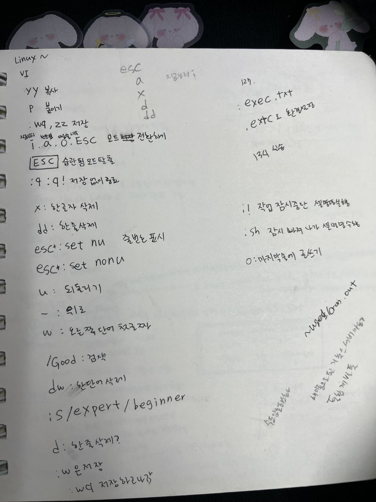
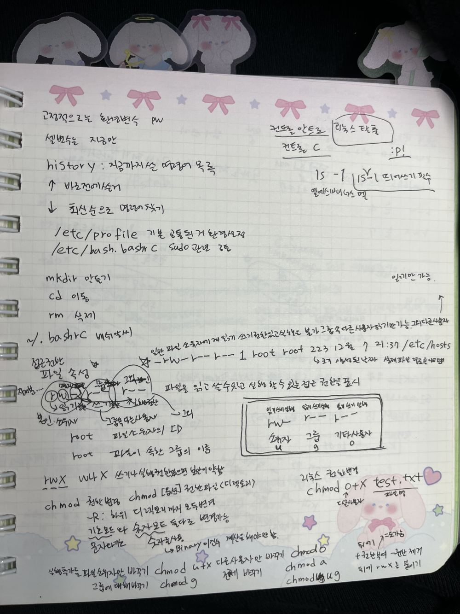
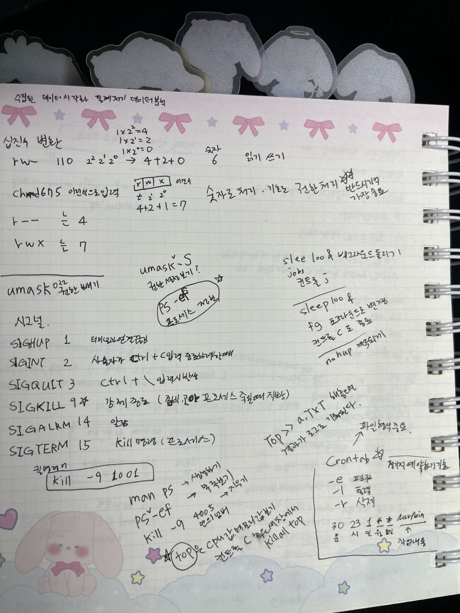
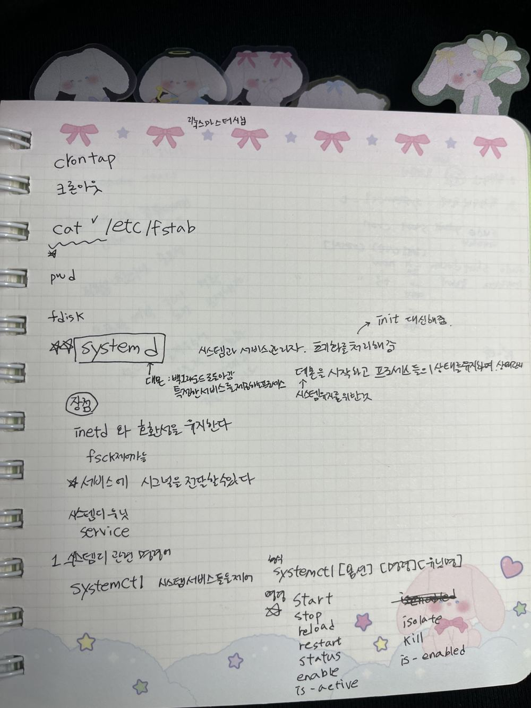
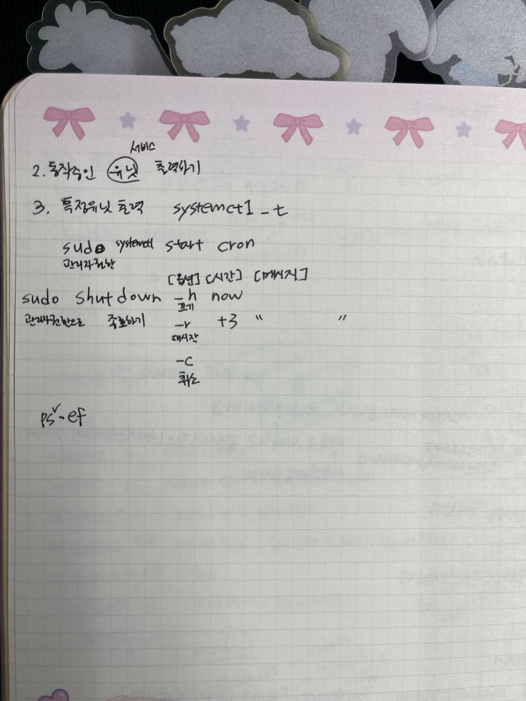
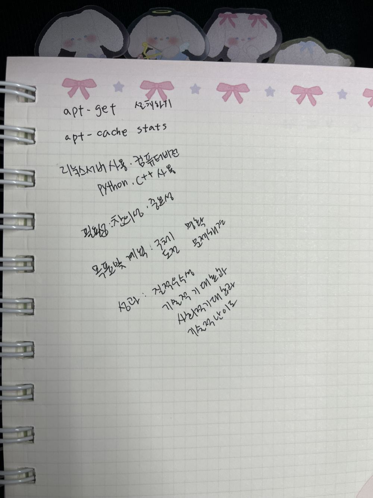
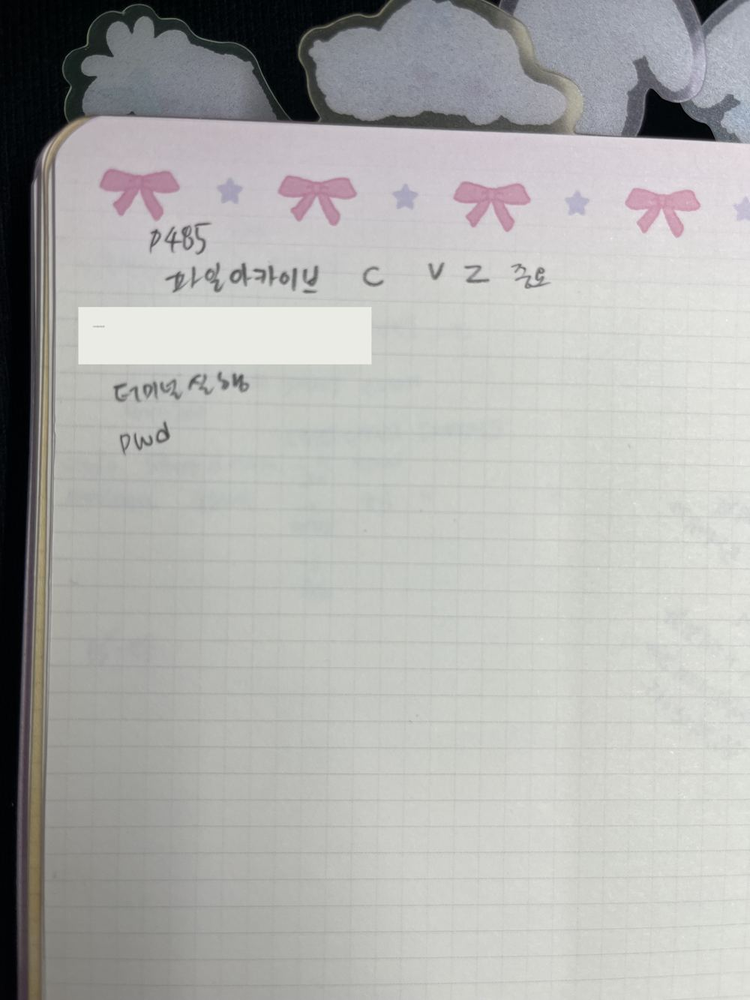

# 리눅스 수업 손필기

금요일 리눅스 수업(리눅스마스터 대비 내용 포함)에서 적은 필기입니다. 내용은 주제별 폴더 README에 정리했습니다.

| 사진 | 내용 | 정리 위치 |
|---|---|---|
|  | vi 명령어 | [02-vim](../02-vim) |
|  | 셸, 파일 속성, chmod 기호 모드 | [01-shell-permissions](../01-shell-permissions) |
|  | 숫자 권한, umask, 시그널, 프로세스, crontab | [01](../01-shell-permissions), [04](../04-process-service) |
|  | systemd, systemctl, fstab | [04](../04-process-service), [05](../05-package-disk-archive) |
|  | systemctl, shutdown | [04-process-service](../04-process-service) |
|  | apt-get, apt-cache (위쪽) | [05-package-disk-archive](../05-package-disk-archive) |
|  | tar 파일 아카이브 | [05-package-disk-archive](../05-package-disk-archive) |

> `p25` 사진의 실습용 계정 비밀번호 부분은 가렸습니다.
